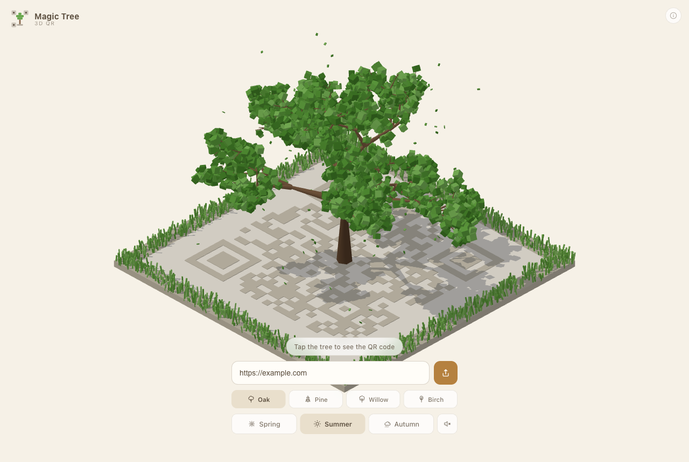

# QR Tree Code

An isometric 3D tree whose plot is a scannable QR code. Type a link, grow a tree, and tap the canopy to watch the leaves fall into the modules of the code below.



Live: https://budd.my.id/qr/

## Features

- Five species — Oak, Pine, Willow, Birch and Palm — each with its own growth rules and silhouette.
- Four seasons, plus six blossom palettes that can be applied in any season. Every QR tone is chosen to stay scannable against the pale plot.
- Rain and fire weather effects that only apply while the canopy is up.
- Deterministic growth: the same link always grows the same tree.
- Share button exports a flat, high-contrast QR PNG with the link printed underneath.
- No external 3D assets: geometry, foliage and ambience are generated at runtime.
- Subtle entrance and feedback animations, disabled automatically under `prefers-reduced-motion`.

## Quick start

```bash
npm install
npm run dev
```

| Command | What it does |
| --- | --- |
| `npm run dev` | Vite dev server |
| `npm run build` | Type-check and build to `dist/` |
| `npm test` | Run the Vitest suite |
| `npm run lint` | Lint with oxlint |

## How it works

The plot is an `InstancedMesh` of one tile per QR module, not a texture. Dark modules sit slightly proud of the light field. The foundation underneath is heart-shaped, with the grass following its outline, while the square module grid and its four-module quiet zone stay untouched so the code still scans. Payloads are encoded at error-correction level H with a four-module quiet zone so the pattern survives the canopy.

Every leaf knows two positions: where it rests on a branch and which module it belongs to once the code resolves. One `morph` value in `[0, 1]` drives leaf position, colour, camera angle and lighting through a 0.95 s transition. Leaves land in flat 3×2 runs at a uniform height — that uniformity is what keeps each module binarising cleanly for a scanner.

The QR matrix, leaf mapping and tree growth are covered by tests; scannability itself was verified in the browser with [jsQR](https://github.com/cozmo/jsQR).

## Repository layout

```text
src/            app source (scene, ui, lib, audio, share)
deployment/     deploy script and notes
docs/           screenshots
.github/        CI workflow
```

See [ARCHITECTURE.md](ARCHITECTURE.md) and [DEPLOYMENT.md](DEPLOYMENT.md).

## Based on

This project is based on the code of:

- The earlier fork `budife/magic-tree-qr` (now deleted) whose code was reused, rewritten and extended here.
- [Magic Tree](https://github.com/Slifronic/magic-tree) by [@Slifronic](https://github.com/Slifronic) — MIT licensed, the upstream of that fork.
- [tree.icqr.com](https://tree.icqr.com) — the original interactive concept that inspired the idea.

Portions of the original MIT-licensed code are retained. The upstream copyright notice and permission text are preserved in [LICENSE-UPSTREAM](LICENSE-UPSTREAM).

## Licence

MIT — see [LICENSE](LICENSE). Copyright (c) 2026 Budi Indra Ilham.

Original portions: Copyright (c) 2026 Magic Tree contributors, under the same MIT licence — see [LICENSE-UPSTREAM](LICENSE-UPSTREAM).
